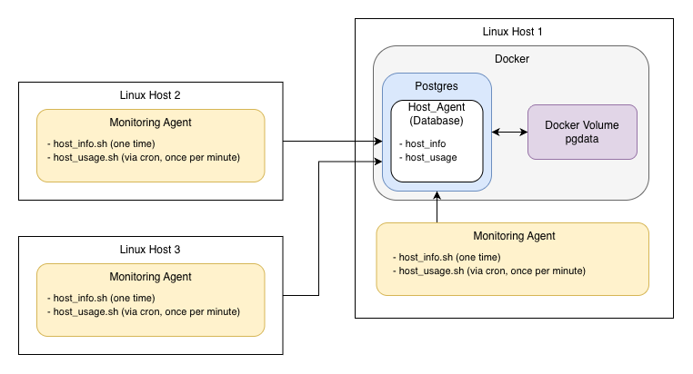

# Linux Cluster Monitoring Agent
This project is under development.
## Introduction
The Linux Cluster Monitoring Agent is a Minimum Viable Product (MVP) developed to support the Jarvis Linux Cluster Administration (LCA) team with infrastructure monitoring which can be used in LCA reports to inform future resource planning.

The MVP was implemented and tested on a single Rocky Linux host, using Bash scripts to collect hardware information, and CPU and memory usage metrics. Docker provides the PostgreSQL database environment, while cron automates collection of Linux host usage data at one-minute intervals. Git and GitHub are used for version control and source code management.

The architecture is designed to scale across multiple Linux hosts by deploying the monitoring agents on additional servers.
## Quick Start
### 1. Docker
Docker is required for this project. Please verify docker is installed on the Linux host using `docker --version`. If docker is not installed, please follow the [Official Docker installation instructions for RHEL-based Linux](https://docs.docker.com/engine/install/rhel).
### 2. Initializing PostgreSQL
Run the following command from within the linux_sql directory:
```
bash scripts/psql_docker.sh create <db_username> <db_password>
```
The above script provisions a Docker container named jrvs-psql and a persistent volume named pgdata.\
PostgreSQL is accessible locally at 127.0.0.1:5432.

To verify the container is running:
```
docker ps
```

Managing an existing container:
```
# Start
bash scripts/psql_docker.sh start

# Stop
bash scripts/psql_docker.sh stop
```

### 3. Creating Tables
Create the application database
```
# Create the application database
psql -h localhost -U postgres -d postgres -c "CREATE DATABASE host_agent;"

# Create tables in the application database
psql -h localhost -U postgres -d host_agent -f sql/ddl.sql
```

### 4. Collecting Host Info
Host info is collected once at project setup. To collect the Linux host hardware data, run the following command:
```
bash scripts/host_info.sh 127.0.0.1 5432 host_agent postgres {password}
```
#### 5. Collecting and Automating Host Usage
The script to collect host usage can be run manually in the same way as host info. For regular collection however, use crontab to initialize a job that collects data once per minute:
```
* * * * * bash /home/rocky/dev/jarvis_data_eng_LucasMichalski/linux_sql/scripts/host_usage.sh 127.0.0.1 5432 host_agent postgres "" > /home/rocky/host_usage_cron.log 2>&1
```

## Implementation
### Architecture
Diagram shows example architecture with three Linux hosts, a DB, and agents.


### Scripts
#### 1. psql_docker.sh
Contains 3 commands (start, stop, create) for managing the PostgreSQL Docker container (jrvs-psql). The script supports creating, starting, and stopping the container. When creating the container, it also configures a persistent Docker volume (pgdata) to preserve database data.

Usage:
```
# Create the PostgreSQL container
bash scripts/psql_docker.sh create postgres <password>

# Start an existing container
bash scripts/psql_docker.sh start

# Stop the container
bash scripts/psql_docker.sh stop
```

#### 2. host_info.sh
Collects the following hardware information from the Linux host and inserts it into the Postgres `host_info` table.
- Hostname
- CPU count
- Architecture
- Model 
- Clock speed
- L2 cache
- Total memory
- Timestamp

Usage:
```bash
bash scripts/host_info.sh \
  <psql_host> \
  <psql_port> \
  <db_name> \
  <psql_user> \
  <psql_password>
```

#### 3. host_usage.sh
Collects the following resource usage information from the Linux host and inserts it into the PostgreSQL `host_usage` table. The script is designed to run automatically every minute using cron, providing continuous resource monitoring, which is detailed after this section.

- Host ID
- Free memory
- CPU idle percentage
- CPU kernel usage percentage
- Disk I/O
- Available disk space 
- Timestamp

Usage:
```bash
bash scripts/host_usage.sh 
  <psql_host> \
  <psql_port> \
  <db_name> \
  <psql_user> \
  <psql_password>
```

#### 4. crontab
Uses cron to automatically execute host_usage.sh once per minute. 

Usage:
```
# Edit the current user's crontab
crontab -e

# Lists the current user's scheduled cron jobs.
crontab -l

# Schedule host_usage.sh to run every minute
* * * * * /bin/bash /path/to/scripts/host_usage.sh 127.0.0.1 5432 host_agent postgres "" >> /path/to/host_usage_cron.log 2>&1
```

#### 5. queries.sql 
Example reference for queries used to insert data into host_info and host_usage.

### Database Modelling
#### host_info
| Column | Data Type | Constraints |
|---|---|---|
| id | SERIAL | PRIMARY KEY |
| hostname | VARCHAR | NOT NULL, UNIQUE |
| cpu_number | INT2 | NOT NULL |
| cpu_architecture | VARCHAR | NOT NULL |
| cpu_model | VARCHAR | NOT NULL |
| cpu_mhz | FLOAT8 | NOT NULL |
| l2_cache | INT4 | NOT NULL |
| timestamp | TIMESTAMP | NOT NULL |
| total_mem | INT4 | NOT NULL |

#### host_usage
| Column | Data Type | Constraints |
|---|---|---|
| timestamp | TIMESTAMP | NOT NULL |
| host_id | INT4 | NOT NULL, FOREIGN KEY → host_info(id) |
| memory_free | INT4 | NOT NULL |
| cpu_idle | INT2 | NOT NULL |
| cpu_kernel | INT2 | NOT NULL |
| disk_io | INT4 | NOT NULL |
| disk_available | INT4 | NOT NULL |

## Testing

The Bash scripts and DDL were tested manually on the Linux host.

### 1. psql_docker.sh
Verified that the `create`, `start`, and `stop` commands successfully manage the PostgreSQL Docker container. The script also handles invalid commands, missing arguments, attempts to create an existing container, and attempts to start or stop a nonexistent container by displaying error messages and returning nonzero exit codes.

### 2. ddl.sql
Initially executed the `CREATE TABLE` statements manually to verify the database schema. The tables were then dropped and recreated by executing `ddl.sql` directly, confirming that the script successfully initializes both tables with the expected columns and constraints.

### 3. host_info.sh
Executed manually to verify that hardware specifications were collected correctly and inserted into the `host_info` table. Confirmed successful insertion by querying the database. The script also validates the number of command-line arguments and returns an error if the database operation fails.

### 4. host_usage.sh
Executed manually to verify that resource usage metrics were collected and inserted into the `host_usage` table with the correct `host_id`. Confirmed successful insertion by querying the database and verified that the script could run repeatedly to collect updated metrics.

### 5. crontab
Configured `host_usage.sh` to execute automatically every minute. Verified that new records were inserted into the `host_usage` table over time, confirming that scheduled data collection was functioning correctly.

## Deployment
The Linux Cluster Monitoring Agent was deployed on a Rocky Linux virtual machine hosted on Google Cloud Platform (GCP) using GitHub, Docker, and cron.

#### GCP and Linux
Provisioned a virtual machine on Google Cloud Platform running Rocky Linux. Connected to the VM using SSH and configured the Linux environment with the necessary dependencies, including Docker, PostgreSQL client tools, and Git.

#### GitHub
Used Git for version control and GitHub to manage the source code through feature branches and a shared development branch.

#### Docker
Deployed PostgreSQL in a Docker container (jrvs-psql) using psql_docker.sh, with a persistent Docker volume (pgdata) for database storage.

#### Monitoring Agents
Deployed the Bash scripts on the Linux host, executing host_info.sh once to collect hardware specifications and configuring host_usage.sh for recurring data collection.

#### Crontab
Scheduled host_usage.sh to execute automatically every minute using cron, collecting usage metrics continuously without manual intervention.

## Improvements
#### 1. Improved logging
Implement append-based logging to preserve historical output rather than overwriting logs with each execution. Log only errors and meaningful events to reduce unnecessary output. Additionally, can use `logrotate` to automatically rotate, compress, and delete older log files, preventing excessive disk storage usage while maintaining useful troubleshooting history.

#### 2. Database security
Improve PostgreSQL authentication by removing passwords from command-line arguments and cron jobs. Use a secure credential management solution, such as PostgreSQL's `.pgpass` file or Google Cloud Secret Manager, and configure a dedicated database user with limited permissions.

#### 3. Error handling and alerting
Implement automated monitoring for failed script executions, database connection errors, and missing resource usage records. Add alerts when a host stops reporting metrics to help identify and resolve monitoring failures promptly.
